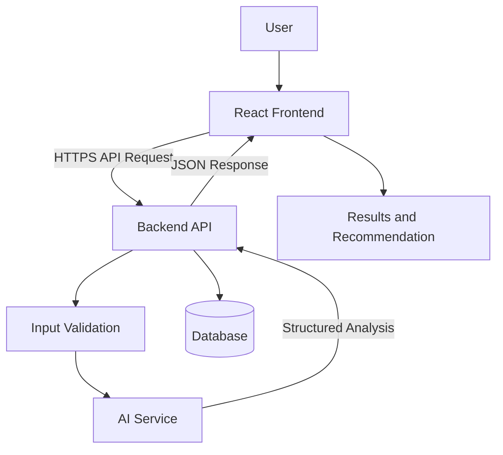

# High-Level Architecture Plan

## Product: AI Decision Helper

## 1. Architecture Overview

AI Decision Helper follows a simple client-server architecture. The frontend collects decision information, the backend validates requests and communicates with the AI service, and the results are returned to the user.

The architecture is designed for rapid MVP development during a 24-hour hackathon.

## 2. Main Components

### Frontend
**Responsibilities:**
- Display the home page and decision input form.
- Allow users to enter a decision, options, and priorities.
- Display pros, cons, comparisons, and recommendations.
- Show loading indicators, validation messages, and errors.

**Suggested technology:** React with Vite and CSS.

### Backend API
**Responsibilities:**
- Receive requests from the frontend.
- Validate decision descriptions and options.
- Coordinate AI analysis.
- Return structured results.
- Manage saved decisions when persistence is implemented.

**Suggested technology:** Python with Flask or FastAPI.

### AI Service
**Responsibilities:**
- Analyze the user's decision and options.
- Generate pros and cons for each option.
- Consider the user's priorities.
- Return a structured recommendation with an explanation.

**Implementation:** Integrate an available AI API through the backend. The API key must remain in server-side environment variables.

### Database
**Responsibilities:**
- Store users when authentication is implemented.
- Store decisions and their options.
- Store completed analyses and decision history.

**Suggested technology:** SQLite for a simple prototype, with PostgreSQL as a future production option.

### Deployment Platform
**Responsibilities:**
- Host the frontend and backend.
- Configure environment variables securely.
- Provide a public URL for the hackathon demo.

**Suggested options:** Vercel for the frontend and Render for the backend, subject to the selected framework and deployment configuration.

## 3. System Architecture Diagram



The database is optional for the first working prototype. If the MVP does not save decisions, the backend can return results directly without persistent storage.

## 4. Main Data Flow

1. The user opens the application.
2. The frontend displays a form for the decision description and available options.
3. The user submits the form.
4. The backend validates the request and checks that at least two options are provided.
5. The backend sends the validated information to the AI service using a controlled prompt.
6. The AI service generates pros, cons, and a recommendation.
7. The backend validates and normalizes the AI response.
8. The backend optionally saves the decision and analysis.
9. The frontend displays the results in a structured comparison.
10. If an error occurs, the frontend displays a helpful message and allows the user to retry.

## 5. Proposed API Endpoints

| Method | Endpoint | Purpose |
|---|---|---|
| GET | `/api/health` | Check whether the backend is running |
| POST | `/api/decisions/analyze` | Analyze a decision and its options |
| POST | `/api/decisions` | Save a decision when persistence is enabled |
| GET | `/api/decisions` | Retrieve saved decisions when persistence is enabled |
| GET | `/api/decisions/:id` | Retrieve a saved decision and its results |

The analysis endpoint is the main requirement for the initial MVP. The persistence endpoints can be added later.

### Example Analysis Request

```json
{
  "title": "Choose a programming course",
  "description": "I want to improve my programming skills.",
  "options": [
    {
      "title": "Online course",
      "description": "Study at my own pace."
    },
    {
      "title": "In-person course",
      "description": "Attend classes with an instructor."
    }
  ],
  "priorities": [
    "cost",
    "flexibility",
    "learning quality"
  ]
}
```

### Example Analysis Response

```json
{
  "pros_cons": [
    {
      "option": "Online course",
      "pros": [
        "Flexible schedule",
        "Potentially lower cost"
      ],
      "cons": [
        "Requires self-discipline"
      ]
    },
    {
      "option": "In-person course",
      "pros": [
        "Direct instructor interaction"
      ],
      "cons": [
        "Fixed schedule",
        "Potentially higher cost"
      ]
    }
  ],
  "recommendation": "Online course",
  "explanation": "This option may fit the stated priorities of cost and flexibility. The final choice depends on the available courses and the user's learning preferences."
}
```

These JSON examples illustrate the proposed API contract; the actual output must be validated by the backend.

## 6. Security and Reliability

- Store AI API keys in backend environment variables.
- Never expose secret keys in frontend code or public repositories.
- Validate and limit request sizes and option counts.
- Handle AI API timeouts, rate limits, and unavailable services.
- Validate the AI response before returning it to the frontend.
- Avoid presenting AI recommendations as guaranteed facts.
- Use HTTPS in deployment.
- Protect saved user data with appropriate authentication and authorization when accounts are introduced.

## 7. Testing Strategy

### Frontend Testing
- Validate form inputs and error messages.
- Check results rendering for multiple options.
- Verify responsive layout on mobile and desktop.

### Backend Testing
- Test valid and invalid requests.
- Verify that fewer than two options are rejected.
- Test AI service failures and malformed responses.
- Test API endpoints using automated tests.

### Integration Testing
- Submit a decision through the frontend.
- Confirm the backend calls the AI service.
- Verify that the response contains valid pros, cons, and a recommendation.
- Confirm that errors are displayed appropriately.

### Deployment Testing
- Check the live frontend URL.
- Check the backend health endpoint.
- Perform a complete end-to-end analysis using the deployed application.

## 8. Implementation Plan

### Phase 1: Core MVP
- Build the decision input form.
- Create the backend analysis endpoint.
- Integrate the AI service.
- Display pros, cons, and recommendations.

### Phase 2: Quality and Testing
- Add input validation and error handling.
- Test the main user workflows.
- Fix critical bugs.

### Phase 3: Deployment
- Deploy the frontend and backend.
- Configure environment variables.
- Test the public demo.

### Phase 4: Optional Enhancements
- Add persistent storage.
- Implement decision history.
- Add user accounts and more advanced priority weighting.

## 9. Architecture Decision

The MVP prioritizes simplicity, fast development, clear separation of responsibilities, and a working end-to-end user flow. Persistent storage, authentication, and advanced personalization are secondary features and should not delay delivery of the initial demo.

## Expected Outcome

A deployed AI Decision Helper that accepts a decision and multiple options, requests an AI analysis, and displays structured pros and cons alongside an explanatory recommendation.
