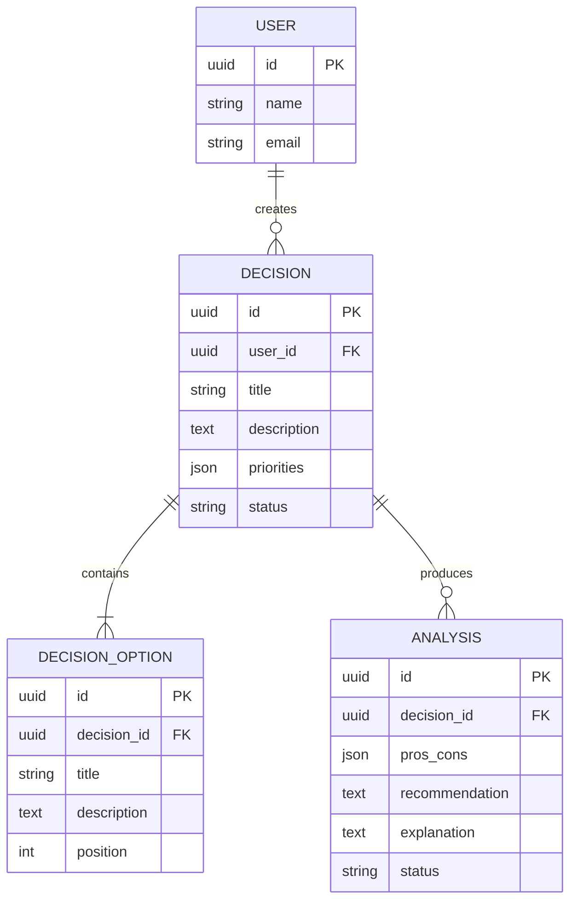

# Data Model

## Product: AI Decision Helper

## Overview

The data model defines the main entities used to store decision requests, their available options, and the AI-generated analyses.

The proposed MVP uses three core entities:

1. User
2. Decision
3. DecisionOption

An additional Analysis entity stores the AI-generated results.

## Entity 1: User

Represents a person using the application.

| Field | Type | Description |
|---|---|---|
| id | UUID | Unique user identifier (primary key) |
| name | String | User's display name |
| email | String | User's email address; unique when authentication is implemented |
| created_at | DateTime | Account creation timestamp |

**Relationships:**
- A user can create multiple decisions.
- Each decision belongs to one user when authentication is implemented.

## Entity 2: Decision

Represents a problem or question that the user wants to evaluate.

| Field | Type | Description |
|---|---|---|
| id | UUID | Unique decision identifier (primary key) |
| user_id | UUID, nullable | Reference to the user who created the decision |
| title | String | Short decision title |
| description | Text | Detailed decision description |
| priorities | JSON | User preferences, such as cost, time, or quality |
| status | String | Current status: draft, processing, completed, or failed |
| created_at | DateTime | Decision creation timestamp |
| updated_at | DateTime | Last update timestamp |

**Relationships:**
- A decision can contain multiple options.
- A decision can have multiple analysis records.
- A decision may belong to a user or remain anonymous in the initial MVP.

## Entity 3: DecisionOption

Represents one alternative being considered.

| Field | Type | Description |
|---|---|---|
| id | UUID | Unique option identifier (primary key) |
| decision_id | UUID | Reference to the parent decision (foreign key) |
| title | String | Name of the option |
| description | Text | Additional information about the option |
| position | Integer | Display order within the decision |
| created_at | DateTime | Option creation timestamp |

**Relationships:**
- Each option belongs to one decision.
- A decision can have two or more options.

## Entity 4: Analysis

Stores the results produced by the AI service.

| Field | Type | Description |
|---|---|---|
| id | UUID | Unique analysis identifier (primary key) |
| decision_id | UUID | Reference to the analyzed decision (foreign key) |
| pros_cons | JSON | Advantages and disadvantages for each option |
| recommendation | Text, nullable | Recommended option or suggested course of action |
| explanation | Text, nullable | Reasoning behind the recommendation |
| status | String | Analysis status: processing, completed, or failed |
| created_at | DateTime | Analysis creation timestamp |

**Relationships:**
- Each analysis belongs to one decision.
- Each decision can have multiple analyses over time.

## Entity Relationships

- User 1 → Many Decisions
- Decision 1 → Many DecisionOptions
- Decision 1 → Many Analyses

## Relationship Diagram

## Data Integrity and Validation

- Every entity must have a unique identifier.
- Each decision option must reference an existing decision.
- Each analysis must reference an existing decision.
- A decision must contain at least two valid options before analysis begins.
- Required fields must be validated before data is stored.
- Foreign-key constraints should prevent invalid relationships.
- User information and saved decisions must be protected from unauthorized access.

## Storage Strategy

For the MVP, the application can use in-memory storage or SQLite during early prototyping. PostgreSQL is a suitable choice when persistent, multi-user storage is required.

AI-generated results should be stored only when persistence is implemented. Sensitive API keys must never be stored in the database or exposed to the frontend.

## Future Improvements

- Add a dedicated Priority entity if priorities become more complex.
- Add user authentication and authorization.
- Add decision history and version tracking.
- Add analysis metadata, such as the AI model used and processing duration.
