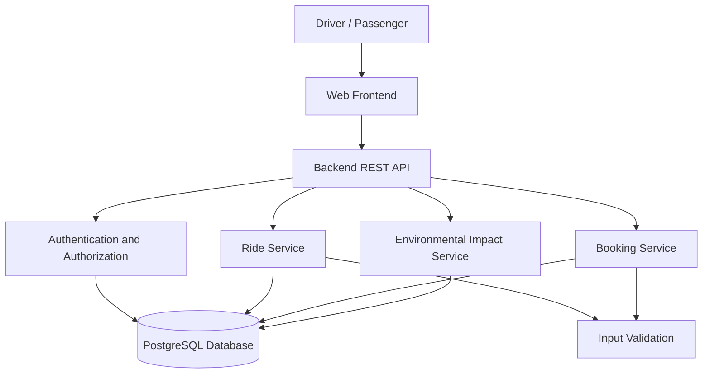

# System Architecture - EcoRide

## 1. Overview

EcoRide is a sustainable ride-sharing MVP that connects drivers with passengers. The system uses a web frontend, a backend API, and a relational database to manage rides and bookings.

## 2. Architecture Diagram

## 3. Main Components

### Frontend
- Displays available rides and ride details.
- Provides forms to create and search for rides.
- Allows passengers to manage bookings.
- Displays estimated environmental impact.

### Backend REST API
- Receives and validates frontend requests.
- Applies ride and booking business rules.
- Prevents duplicate bookings and overbooking.
- Returns structured responses and error messages.

### Authentication and Authorization
- Identifies drivers and passengers.
- Restricts ride management to the ride owner.
- Restricts booking management to the relevant passenger.

Authentication can be simplified for the initial prototype, but production deployment should use secure authentication.

### Ride Service
- Creates, retrieves, and updates ride listings.
- Filters rides by location and date.
- Checks seat availability.

### Booking Service
- Creates and cancels bookings.
- Updates available seat counts.
- Prevents duplicate bookings and overbooking.

Booking creation and seat updates must be handled atomically to avoid concurrent booking errors.

### Environmental Impact Service
- Estimates CO2 savings using a simplified calculation.
- Returns an estimated savings value for display in the frontend.

### PostgreSQL Database
- Stores users, rides, and bookings.
- Maintains relationships and data integrity through primary keys, foreign keys, and constraints.

## 4. Example API Endpoints

| Method | Endpoint | Purpose |
|---|---|---|
| GET | `/api/rides` | Search and list rides |
| GET | `/api/rides/:id` | Retrieve ride details |
| POST | `/api/rides` | Create a ride |
| PUT | `/api/rides/:id` | Update a ride |
| POST | `/api/rides/:id/bookings` | Book a seat |
| GET | `/api/bookings` | View passenger bookings |
| PATCH | `/api/bookings/:id/cancel` | Cancel a booking |
| GET | `/api/impact` | Retrieve environmental impact estimates |

## 5. Technology Stack

- Frontend: React
- Backend: Node.js and Express
- Database: PostgreSQL
- Testing: Jest and Supertest
- Deployment: Vercel for the frontend and Render for the backend

## 6. Constraints

- The MVP will focus on essential ride-sharing functionality.
- Online payments and live GPS tracking are excluded.
- CO2 savings are estimates rather than verified measurements.
- The backend must validate all incoming data and enforce booking rules.
